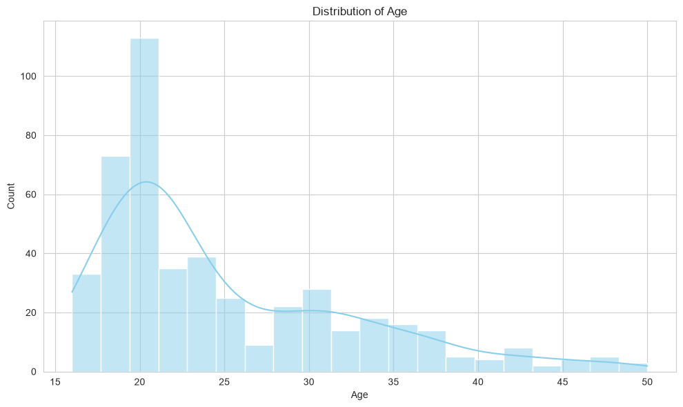
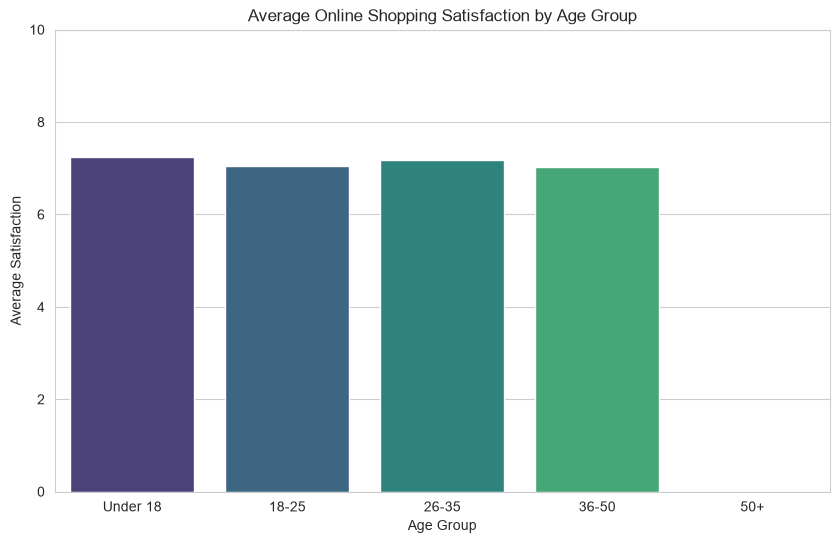
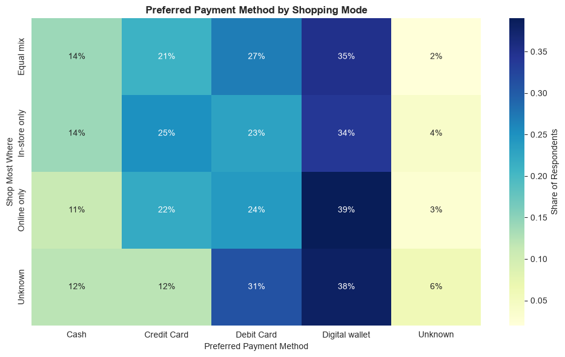

# Ecommerce Consumer Shopping Behavior Analysis

An exploratory analysis of **500 consumer survey responses** to understand how people shop online and in stores, what influences their decisions, and how shopping patterns vary across customer groups. The project uses Python to clean and summarize the survey data, then presents the findings in four visualizations.

> **At a glance:** respondents lean toward a mix of online and in-store shopping, while variety and convenience are the most frequently reported reasons for shopping online. Digital wallets are the most common payment method in every shopping-mode group analyzed.

## Project Contents

| File | Description |
| --- | --- |
| [`consumer_shopping_behavior_survey.csv`](Ecommerce/consumer_shopping_behavior_survey.csv) | Survey dataset (500 rows, 30 columns) |
| [`data_analysis.ipynb`](Ecommerce/data_analysis.ipynb) | Data preparation, exploratory analysis, summary tables, and charts |
| [`assets/`](assets/) | PNG exports of every visualization in the notebook |

## Questions Explored

- Where do respondents shop most often: online, in-store, or a mix of both?
- What reasons do respondents give for preferring online shopping?
- How do satisfaction, trust, and purchase regret compare across age groups and countries?
- Do payment preferences differ by shopping mode?
- How do discount importance and spending categories vary across respondents?
- What data-quality issues should be considered when interpreting the results?

## Tools and Methods

- **Python** — analysis and data preparation
- **pandas, NumPy** — data inspection, cleaning, grouping, and cross-tabulation
- **Matplotlib, Seaborn** — visualizations
- **Jupyter Notebook** — reproducible, cell-by-cell workflow

The notebook loads the CSV, checks its shape, columns, missing values, and duplicate rows, converts selected data types, derives age groups, and uses grouped summaries, frequency tables, pivot tables, and plots to explore the survey.

## Data Preparation

- The dataset contains **500 responses and 30 columns**. No exact duplicate rows were found.
- `Age` was converted to numeric values; values that could not be converted become missing. There are **470 usable numeric ages** (mean **25.02**, median **22**).
- `Timestamp` was parsed using the day/month/year and time format in the source file.
- Age was grouped into **Under 18**, **18–25**, **26–35**, **36–50**, and **50+** bands. There are no respondents in the `50+` group; the oldest recorded age is 50.
- Missing values in six categorical fields (gender, occupation, country, primary shopping mode, preferred platform, and payment method) were labeled `Unknown` for analysis.
- **30 responses (6% of the dataset)** have no answers across all six end-of-survey fields: satisfaction, review trust, purchase regret, online-shopping reason, in-store-shopping reason, and best shopping mode. These rows were identified as possible survey drop-offs; they were **not removed** from the source dataset.
- Other missing values remain missing. Summary statistics use the available responses for each measure, so the valid sample size can differ between metrics.

## Visualizations

### Age distribution



The sample is concentrated among younger adults: the **18–25** group is the largest, followed by respondents aged **26–35**. The plotted distribution is based on the 470 numeric ages.

### Average online-shopping satisfaction by age



Mean satisfaction is similar across observed age groups, ranging from **7.02 to 7.25**. The under-18 group has the highest observed average (**7.25**); the 36–50 group has the lowest (**7.02**). These small differences do not by themselves establish meaningful differences between age groups.

### Preferred payment method by shopping mode



Digital wallets are the leading payment method in each shopping-mode group shown: **39%** among online-only shoppers, **35%** among respondents who use an equal mix, and **34%** among in-store-only shoppers. The percentages are within each shopping-mode row.

### Discount importance by shopping mode

![Discount importance by shopping mode]Ecommerce/(assets/discount-importance-by-shopping-mode.png)

Discount-importance scores are similar across shopping modes. The median is **4 out of 5** in all three groups, suggesting discounts matter broadly in this sample rather than being unique to one channel.

## Key Findings

### Shopping behavior

- Of the **484** respondents with a recorded primary shopping mode, **248 (51.2%)** reported an equal mix of online and in-store shopping, **165 (34.1%)** online-only, and **71 (14.7%)** in-store-only.
- Among the **446** respondents with a recorded reason for preferring online shopping, **170 (38.1%)** selected more variety and **157 (35.2%)** selected convenience. Better prices accounted for **81 (18.2%)** responses; 38 selected “Not applicable.”
- Smartphones were the most common primary device: **315 of 492** respondents with a recorded device (**64.0%**).
- Global marketplaces (**141**) and local e-commerce platforms (**140**) were nearly tied as preferred platforms, followed by brand websites (**113**).
- Clothing was the most frequently reported top-spending category: **179 of 476** non-missing responses (**37.6%**), ahead of groceries (**92**) and electronics (**76**).

### Customer experience

- Average online-shopping satisfaction was **7.13** across the **457** non-missing scores.
- Average review-trust score was **6.16** across the **450** non-missing scores.
- Age-group satisfaction averages are close: **7.25** for Under 18, **7.04** for 18–25, **7.17** for 26–35, and **7.02** for 36–50.
- For the eight most represented countries examined in the notebook, mean satisfaction ranged from **6.52** in Egypt (25 respondents) to **7.43** in Indonesia (26 respondents). These group sizes are limited and should be treated as descriptive, not as country-level market estimates.

### Payments and promotions

- Digital wallets are the leading payment preference across all three recorded shopping modes in the payment-method comparison.
- Discount importance has a median score of **4/5** across equal-mix, online-only, and in-store-only shoppers. Average scores are also close: **3.76**, **3.85**, and **3.91**, respectively.
- The notebook also compares spending categories by gender and summarizes impulse-purchase, discount, and buy-now-pay-later (BNPL) measures by occupation. These are exploratory breakdowns, not causal relationships.

## Potential Actions

1. **Make shopping work well on mobile.** Smartphones are the most common primary device in the survey, so prioritize mobile navigation, search, checkout, and page performance.
2. **Improve product discovery and convenience.** Variety and convenience dominate stated online-shopping reasons; make assortment easy to browse and reduce friction in delivery and checkout.
3. **Offer flexible payment options.** Digital wallets lead in every shopping-mode group, while debit and credit cards remain common alternatives. Support a choice of trusted payment methods.
4. **Keep promotions relevant across channels.** Discount importance is consistently high across shopping modes. Test promotion formats by channel rather than assuming discounts only matter to online shoppers.
5. **Treat age and country differences as hypotheses.** The observed satisfaction gaps are small and group counts vary. Gather more representative data and validate differences before using them for targeted decisions.

These are practical implications suggested by the survey patterns, not measured outcomes of implemented business changes.

## Limitations

- The analysis describes a survey sample; the notebook does not establish that it represents all ecommerce customers or any particular market.
- Responses are self-reported and may reflect recall or selection bias.
- Missing answers—especially the 30 rows with all six end-of-survey fields blank—reduce the sample size for some measures.
- The analysis is descriptive. It does not test statistical significance, estimate causal effects, or include sales, conversion, or revenue data.
- The age band `50+` has no observations, and some country and occupation groups are small.

## Run the Notebook

From this directory, install the required packages and launch Jupyter:

```bash
python -m pip install pandas numpy matplotlib seaborn jupyter
jupyter notebook data_analysis.ipynb
```

Run the notebook cells from top to bottom. The CSV is loaded by a relative filename, so keep the notebook and CSV together in this folder.

## Repository Layout

```text
Ecommerce/
├── README.md
├── consumer_shopping_behavior_survey.csv
├── data_analysis.ipynb
└── assets/
    ├── age-distribution.png
    ├── satisfaction-by-age-group.png
    ├── payment-method-by-shopping-mode.png
    └── discount-importance-by-shopping-mode.png
```
